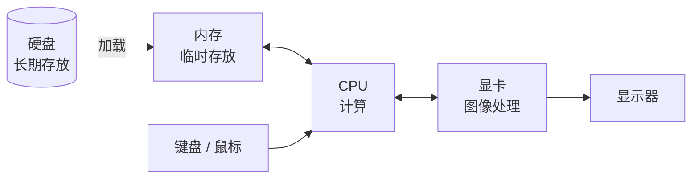
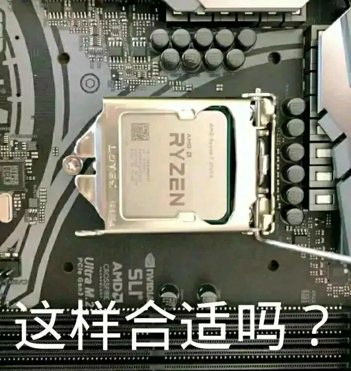
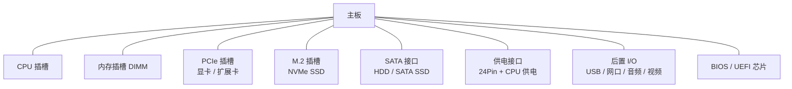
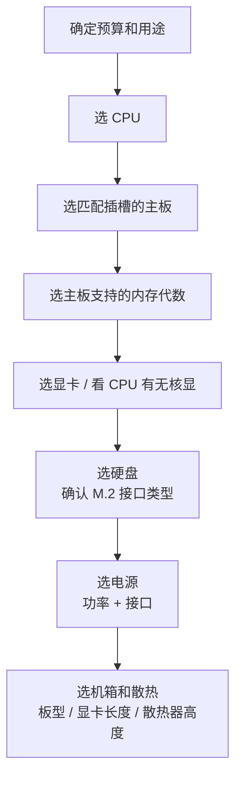

# 硬件组成简介

> [!WARNING]
> 本文内容属于科普范畴，尽量写的简单易懂，省略了很多细节和专业术语

一台电脑从外面看是一个盒子，打开以后其实就是几块各管一摊的零件

了解每个零件是干什么的、彼此怎么连，装机、升级、排查故障都会轻松很多

## 电脑是怎么工作的

先不管具体零件，电脑干活的流程大致是这样的：

1. 硬盘里存着程序和数据
2. 运行程序时，系统把需要的部分搬到内存里
3. CPU 从内存里取指令、取数据，计算
4. 需要画面时，交给显卡处理，再通过接口输出到显示器
5. 键盘、鼠标等设备把你的操作送回给 CPU，开始下一轮

这些零件之间的连接全靠主板。主板上有各种插槽和走线，可以理解为一座城市的道路系统，其他零件都是住在里面的居民

> [!NOTE]
> 本文默认讨论 **Windows 台式机和笔记本** 使用的 x86-64 平台。手机、Mac（Apple 芯片）、开发板等把大部分零件集成在一颗芯片上，思路相似，但不在本文范围内

## 核心部件一览

| 部件              | 简单作用                           | 类比           |
| ----------------- | ---------------------------------- | -------------- |
| CPU（处理器）     | 执行指令，负责计算和调度           | 大脑           |
| 内存（RAM）       | 临时存放正在运行的程序和数据       | 工作台         |
| 硬盘（SSD / HDD） | 长期存放系统、软件和文件           | 仓库           |
| 主板              | 连接并为各部件提供通道             | 骨架 + 神经    |
| 显卡（GPU）       | 处理图形和并行计算                 | 专职画图的助手 |
| 电源（PSU）       | 把市电转换成各部件需要的低压直流电 | 心脏           |
| 散热器            | 把 CPU 等发热部件的热量带走        | 空调           |
| 机箱              | 固定、保护所有部件，规划风道       | 房子           |

下面逐个说

## CPU

CPU，Central Processing Unit，中央处理器是电脑的运算核心。写的每一行代码、点的每一次鼠标，任何一个行为最后都会变成一条条指令交给它执行

几个常见参数：

| 参数            | 含义                                                                                                                       |
| --------------- | -------------------------------------------------------------------------------------------------------------------------- |
| 核心数 / 线程数 | 核心越多，能同时处理的任务越多。现在很多 CPU 线程数是核心数的两倍（超线程技术），但对于超线程 CPU 一个线程并不等于半个核心 |
| 主频            | 每秒运行的时钟周期数，现代 CPU 的频率单位是 GHz，同代同架构下越高越快，不同代之间不能直接比                                |
| 缓存            | CPU 内部的高速小内存，比 RAM 快得多，容量一般以 MB 计                                                                      |
| TDP / 功耗      | 粗略反映发热和供电需求                                                                                                     |
| 接口（插槽）    | 决定能插进哪块主板                                                                                                         |

目前主流的桌面 CPU 厂商是 Intel 和 AMD，两家使用的主板插槽不同，**不能混用**

> [!TIP]
> 看性能别只看主频和核心数。同样是 4 GHz，新架构一个周期干的活比老架构多得多。想比较性能，去看对应型号的实际跑分或者评测

### 核显

很多 CPU 里自带一块简单的显示核心，叫核显。办公、看视频、写代码足够用，打大型游戏、跑 AI 就不太行了

不带核显的 CPU 必须再插一块独立显卡才有画面输出，买之前要看清楚，不然装好机发现点不亮就尴尬了

> [!TIP]
> 除了核显，还有集显，集成显卡，是指显卡集成在主板上，和核显的区别是集显不在 CPU 里，而是主板芯片组里。不过现在几乎没有新家用主板带集显了，在服务器主板上还是有的

## 内存

内存（RAM）速度很快，但**断电就清空**，所以只用来放正在运行的东西。内存越大，能同时开的程序越多，也越不容易因为不够用而卡顿

| 代数 | 常见场景                           |
| ---- | ---------------------------------- |
| DDR3 | 较老的平台，多见于二手和低成本整机 |
| DDR4 | 主流平台                           |
| DDR5 | 新平台                             |

> [!WARNING]
> 不同代数的内存插槽的缺口位置不一样，**物理上就插不进对方的插槽**。不要硬怼！！！买内存之前先确认主板支持哪一代

几个容易搞混的点：

- 台式机内存条比笔记本的长，笔记本用的叫 SO-DIMM，两者不通用
- 双通道：插两根同规格的内存条，带宽几乎翻倍，比单根大容量更划算。一般插在主板说明书推荐的槽位上，不过双通道的支持也要看主板和 CPU，**不是所有平台都支持双通道**
- 内存满了以后，系统会把一部分数据挪到硬盘上的页面文件里，速度会断崖式变慢，这就是内存不够时电脑变卡的原因（页面文件的事情在 [操作系统与文件系统章节](OS.md#磁盘分区与盘符) 提过）

> [!TIP]
> 内存频率和时序在 BIOS 里需要开启 XMP / EXPO，否则内存会按默认的低频率运行，达不到商品页写的频率，例如 6400 MHz

## 硬盘

硬盘负责长期保存数据，主要有两类：

| 类型         | 原理                       | 速度 | 价格             | 特点           |
| ------------ | -------------------------- | ---- | ---------------- | -------------- |
| HDD 机械硬盘 | 磁头在高速旋转的盘片上读写 | 慢   | 容量大，单价较低 | 怕震动，有噪音 |
| SSD 固态硬盘 | 闪存芯片存储，没有机械结构 | 快   | 单价较高         | 安静，抗震     |

现在系统盘直接上 SSD，没有悬念。HDD 更适合用来放不常用的大文件，比如备份、影视资料

### SSD 的接口

同样叫 SSD，接口却有好几种，外形和速度差别很大：

| 类型     | 外观           | 协议                | 大致速度                 |
| -------- | -------------- | ------------------- | ------------------------ |
| SATA SSD | 2.5 英寸小方盒 | SATA                | 约 500 MB/s              |
| M.2 SATA | 口香糖条状     | SATA                | 约 500 MB/s              |
| M.2 NVMe | 口香糖条状     | NVMe（底层为 PCIe） | 从 3000 MB/s 到上万 MB/s |

> [!WARNING]
> **M.2 接口不等于 NVMe！！！** M.2 只是外形，里面跑 SATA 还是 NVMe 要看具体型号。而且有的主板 M.2 槽只支持其中一种。买之前一定先翻主板说明书

### 容量标注

厂商按 1 GB = 1000 MB 算，而 Windows 按 1 GB = 1024 MB 算，所以标称 1 TB 的硬盘插上去只显示约 931 GB。这是单位换算问题，不是被坑了

## 主板

主板是整台电脑的底座，所有零件都要插在它上面，它决定了你能用什么 CPU、什么内存、几块硬盘、多少 USB 接口

### 芯片组

芯片组决定了主板的功能上限，比如能插几个 M.2、有多少个 USB 3.x 接口、支不支持 CPU 超频。同一个 CPU 插槽下，往往有高中低多种芯片组可选，**价格差距主要来自这里**

### 板型

| 板型               | 尺寸 | 特点                 |
| ------------------ | ---- | -------------------- |
| ATX                | 最大 | 扩展槽多，适合大机箱 |
| Micro-ATX（M-ATX） | 中等 | 插槽够用，性价比高   |
| Mini-ITX           | 最小 | 小机箱专用，插槽少   |

板型要和机箱匹配：大板子装不进小机箱，小板子可以装进大机箱

~当然，也可以不需要机箱，就不用考虑这些了~

### BIOS / UEFI

主板上有一块固件芯片，里面存着最底层的启动程序，开机后最先运行的就是它。现在基本都是 UEFI，也习惯性叫 BIOS。可以在里面调整启动顺序、开启 XMP、查看硬件状态等

> [!TIP]
> 开机时连续按 `Del` 或 `F2`（不同品牌不一样，常见的还有 `F10`、`F12`）可以进入 BIOS。具体按键开机画面一般有提示

> [!TIP]
> 严格来说 UEFI 主要是由两块芯片组成的，一块是主板上的固件芯片，平时只可读；另一块是 CMOS 芯片，自定义的 UEFI 设置都是存储在 CMOS 里，平时是靠主板上的纽扣电池供电的，所以拔掉电池或放电会清空 CMOS，BIOS 设置会恢复出厂

## 显卡

显卡（GPU）负责图形渲染。现在它的用途已经不只是玩游戏，视频剪辑、3D 建模、AI 训练和推理都靠它

| 类型     | 说明                                                   |
| -------- | ------------------------------------------------------ |
| 集成显卡 | 在 CPU 里，共用系统内存，没有独立显存，性能弱，功耗低  |
| 独立显卡 | 有专用显存和散热，插在主板 PCIe 插槽上，性能强，功耗高 |

选显卡时最该看的几项：

- **显存容量**：影响能跑多大的游戏画质、多大的 AI 模型，不够用就爆显存卡成幻灯片
- **GPU 本身的型号和代数**：同系列里数字越大一般越强，但跨代不能只看数字
- **功耗和供电接口**：要确认电源功率够，接口对得上
- **长度和厚度**：要确认机箱装得下

> [!NOTE]
> 笔记本的独显通常焊死在主板上，**不能更换**。买之前就要想好需求

## 电源

电源把插座里的 220V 交流电转成电脑内部需要的 12V、5V、3.3V 直流电

电源出问题的后果可能最严重：轻则重启蓝屏，重则烧掉其他硬件

挑电源要看：

| 项目         | 说明                                         |
| ------------ | -------------------------------------------- |
| 额定功率     | 够用并留点余量即可，也不是越大越好           |
| 80 PLUS 认证 | 标明转换效率，从白牌到钛金牌逐级提高         |
| 接口         | 有没有显卡需要的供电口，有没有足够的 SATA 口 |
| 模组化       | 模组电源的线可以拆，理线方便，价格略高       |

> [!WARNING]
> 电源不要买来路不明的杂牌！！！省下几十块钱，搭进去的可能是整机硬件。电源也是需要看口碑的东西，因为问题都是概率性的，口碑好的品控好一点，出问题的概率就小

估算功率的方法：CPU 和显卡的功耗相加，再加上约 100W 给其他部件，然后留 20% 左右的余量，就是比较合适的额定功率

> [!TIP]
> 如果使用 AMD 显卡请务必留出更多余量，多 300W 都不为过。俗话说的好，N 卡偷 U，A 卡偷电
>
> 这一块又涉及到经典的 A 卡容易掉驱动的问题，至少有一半的原因是功耗管理的问题（个人认为）

## 散热与机箱

CPU 和显卡运行时会发热，温度过高会自动降频（降低性能来保护自己），严重时直接关机。常见的散热方式：

| 方式           | 特点                                                                       |
| -------------- | -------------------------------------------------------------------------- |
| 风冷           | 一个金属散热片加风扇，便宜、可靠、好维护                                   |
| 水冷（一体式） | 冷头 + 水管 + 冷排，高负载下散热更强，装起来更复杂，有漏液、水泵故障的风险 |

~千万不要碰分体水~

机箱除了装东西，还有一个重要作用：规划风道。一般是前进后出、下进上出，让冷风进来经过发热部件，再被带到外面

> [!TIP]
> 灰尘是散热的最大敌人。建议根据使用情况每半年到一年清理一次灰，用吹风机的冷风或气吹就可以。清灰前要断电，并摸一下金属外壳释放静电

## 外设与接口

主机之外的设备都算外设：显示器、键盘、鼠标、音箱、打印机等。它们通过各种接口连接到主机

| 接口              | 常见用途               | 备注                                             |
| ----------------- | ---------------------- | ------------------------------------------------ |
| USB-A             | 鼠标、键盘、U 盘       | 最常见的方头接口                                 |
| USB-C             | 手机、笔记本、移动硬盘 | 正反都能插；但外形一样不代表功能一样~，气死我了~ |
| HDMI              | 显示器、电视           | 视频 + 音频                                      |
| DisplayPort（DP） | 显示器                 | 高刷新率显示器常用                               |
| RJ45              | 网线                   | 有线网络                                         |
| 3.5mm 音频口      | 耳机、麦克风           | 台式机通常按颜色区分                             |

> [!WARNING]
> **USB-C 只是一种插头形状**，里面可以跑 USB 2.0、USB 3.x、雷电、DP 视频输出、充电等不同的东西，不同口的能力完全不同。想知道某个口支持什么，要看产品说明书或旁边的标识

### 显示器要接在哪里

显示器的线应该插在**显卡**的接口上，而不是主板上的接口上。装了独显以后，主板后面的视频口通常就没用了，不少人第一次装机会插错，然后发现没有画面

## 台式机与笔记本

| 对比项     | 台式机               | 笔记本                                     |
| ---------- | -------------------- | ------------------------------------------ |
| 可升级性   | 高，大部分零件都能换 | 低，一般只能换内存和硬盘，部分机型内存焊死 |
| 同价位性能 | 强                   | 弱                                         |
| 便携性     | 无                   | 有                                         |
| 散热       | 好                   | 受限，容易高温                             |
| 维修难度   | 低                   | 高                                         |

笔记本的 CPU 和显卡虽然名字和台式机相似，但功耗被限制过，性能并不一样。不能只看型号名称，要看具体的功耗释放和评测

## 在 Windows 里查看硬件信息

不用拆机，也能知道电脑里装了什么：

| 方法                                     | 信息                                  |
| ---------------------------------------- | ------------------------------------- |
| 任务管理器（`Ctrl + Shift + Esc`）→ 性能 | CPU、内存、磁盘、GPU 的型号和实时占用 |
| `Win + R` 输入 `msinfo32`                | 系统和硬件的详细信息汇总              |
| `Win + R` 输入 `dxdiag`                  | 显卡、声卡信息，DirectX 版本          |
| 设备管理器（`Win + X` + `M`）            | 所有硬件列表以及驱动状态              |
| 磁盘管理（`Win + X` + `K`）              | 硬盘分区情况                          |

> [!TIP]
> 想要更详细的信息，比如传感器温度、内存颗粒、主板型号，可以使用 CPU-Z、GPU-Z、HWiNFO 这类第三方工具。务必从官网下载

## 常见问题

### 按下开机键没有任何反应

按这个顺序排查，由易到难：

1. 电源线有没有插紧，插排有没有开关
2. 电源背面的开关是否打开
3. 机箱前面板开机线是否插对（可以用螺丝刀短接主板上的开机针脚测试）
4. 内存、显卡是否插紧
5. 以上都没问题，大概率是电源或主板出问题

### 开机有风扇转但是没画面

- 检查主板上的 Debug 灯
- 显示器线插到显卡上了吗，而不是主板上
- 显示器输入源选对了吗
- 重新插拔内存条，换一根或换一个槽位试试
- 没有核显的 CPU 必须有独显才有画面

### 电脑越用越慢

- 内存是否占满（任务管理器可看）
- 系统盘是不是快满了，或者还在用 HDD
- 有没有过热降频，可以用 HWiNFO 看温度
- 开机自启动的软件是不是太多

### 为什么我新买的硬盘容量比标的小

这是 1000 和 1024 的换算问题，不是缺斤少两，参见[容量标注](#容量标注)

## 装机前的检查清单

如果你打算自己组一台电脑，下单前把这些对一遍：

- CPU 插槽和主板插槽是否一致
- 内存代数和主板是否一致
- 主板板型和机箱是否匹配
- 显卡长度，机箱能不能装下
- 散热器高度，机箱侧板能不能盖上
- 电源功率和接口是否满足
- 如果没有核显，一定要有独显
