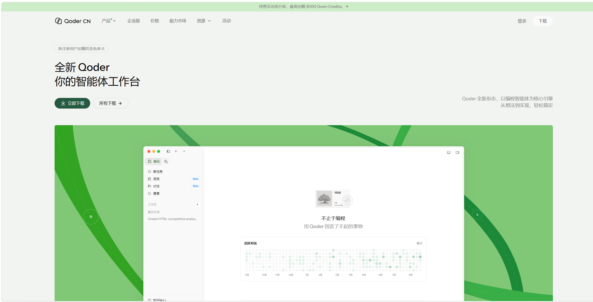
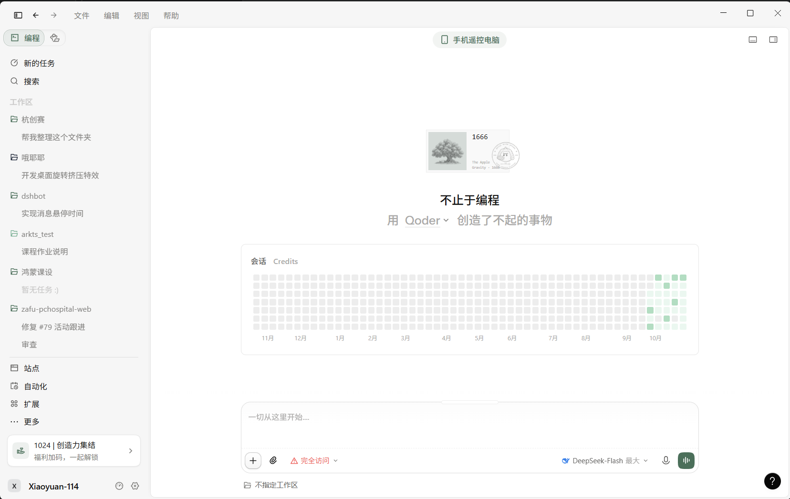
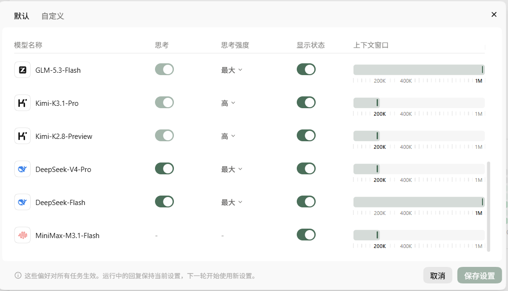
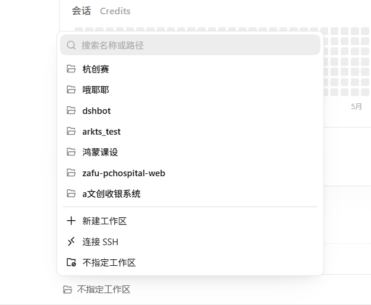
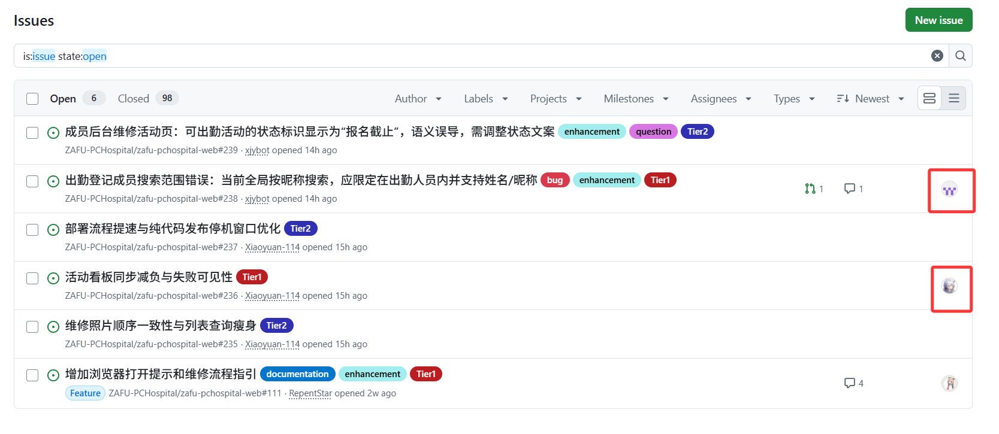
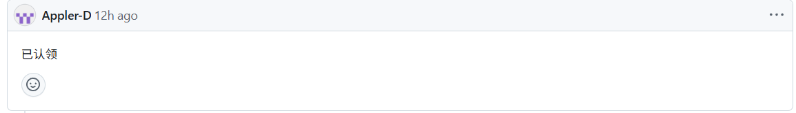
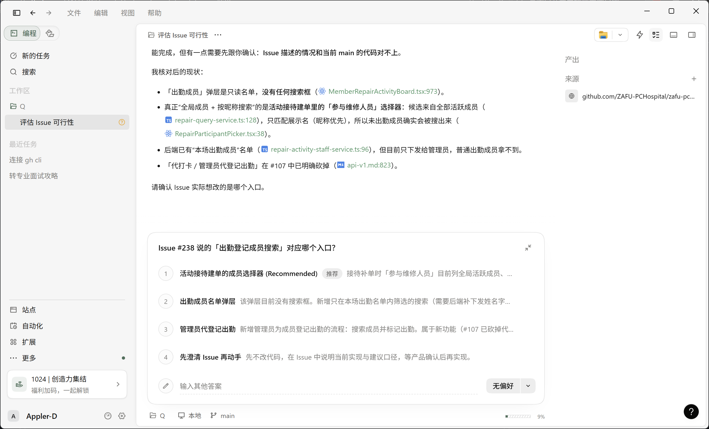
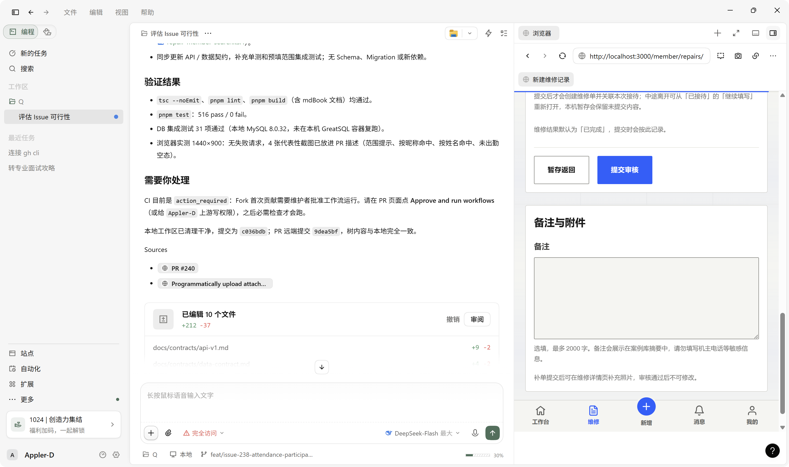
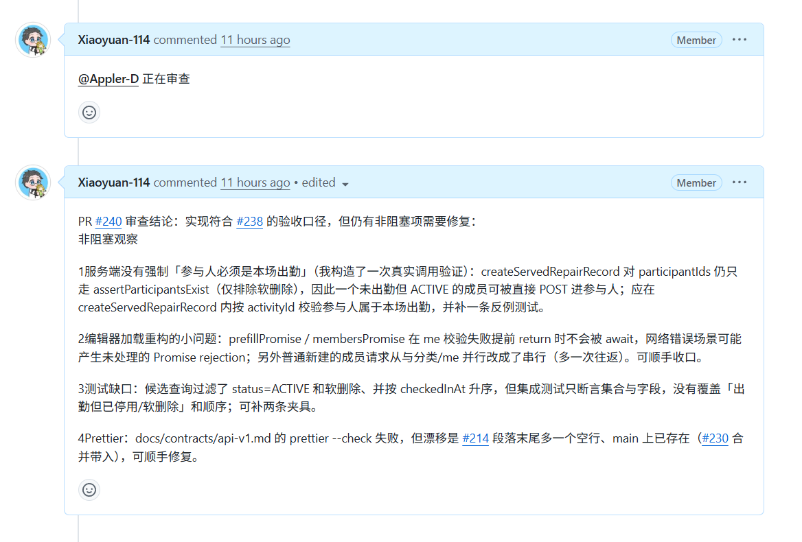

# 电脑医院官网维护教程——以 Qoder 为例

## 一、引言

平时用豆包这类聊天工具，如果你说“我想做一个贪吃蛇小程序”，它通常会给出一段代码。接下来还得自己复制到编辑器里，安装依赖、运行，遇到报错再回去问。

Agent 工具给大模型提供了“手和脚”，让它可以直接读写文件、运行命令、编译和测试代码。有些工具还能打开浏览器、查看截图，帮你检查页面效果。Qoder、WorkBuddy、Claude Code 等都可以做这些事。

本文以 Windows 下的 Qoder CN 桌面版为例，介绍怎么用 Agent 协助维护电脑医院官网。没有开发经验也可以从小任务开始，不过改完以后还是要自己看看效果，不能只听模型说“做好了”。

## 二、下载 Qoder 与初始化

### 下载安装

打开 [Qoder CN 下载页](https://qoder.cn/download)，选择适合自己系统的桌面版。本文用的是桌面版，不是 IDE 或 CLI，下载时看一下名称。



下载后双击安装包，按提示安装，随后打开 Qoder，注册并登录。


下面就是首页了，输入框右下角可以选择模型，下方可以选择工作区。



### 选择模型

截图中用的是 DeepSeek-Flash，也可以换成自己习惯的模型。部分模型会消耗 Credits，选的时候看一下界面上的消耗说明，赠送活动和价格以当时显示的为准。

模型管理里可以调整上下文窗口，也就是模型一次能处理多少内容。刚开始保留默认值即可，不必一上来就拉到 1M；窗口大一些能容纳更多内容，但不等于模型会一直记得之前说过的话。



## 三、环境配置

### GitHub 账号与工具

首先需要一个 GitHub 账号，没有的话可以在 [GitHub 注册页](https://github.com/signup)注册。后面会用到两个词：Issue 是记录问题和需求的地方，PR（Pull Request）则是把修改交给维护者审查的请求。

接着安装 Git 和 GitHub CLI。前者用来管理代码版本，后者的命令叫 `gh`，可以用来操作 GitHub。打开 Qoder，输入：

```text
帮我检查电脑上有没有 Git 和 GitHub CLI，没有的话从官方渠道安装，再带我完成 GitHub 登录，确认登录的是我的账号。
```

按提示在浏览器中授权即可。配置好后，Agent 就能用你的账号协助处理 Issue、提交 PR，能做哪些操作取决于账号本身的权限。其他工具如果有官方 GitHub 连接器，也可以直接使用。

### 创建工作区

在准备存放代码的位置新建一个文件夹，例如 `E:\projects\pchospital`，文件夹名尽量用英文。

打开 Qoder，在输入框下方点击工作区，选择“新建工作区”，添加刚才的文件夹。



后续代码会放在这里，每次开始任务前看一眼有没有选错工作区。

### 下载代码

官网代码在 [zafu-pchospital-web](https://github.com/ZAFU-PCHospital/zafu-pchospital-web)，本教程所在的[文档仓库](https://github.com/ZAFU-PCHospital/ZAFU-PCHospital-Doc)是另一个仓库，别弄混了。

1. 打开官网代码仓库，点击 **Fork**，在自己的账号下复制一份仓库。
2. 把自己的 Fork 地址发给 Qoder，让它克隆到工作区，并把组织仓库设为 `upstream`，以后用来同步上游更新。
3. 让它先读 [README](https://github.com/ZAFU-PCHospital/zafu-pchospital-web/blob/main/README.md)、[贡献指南](https://github.com/ZAFU-PCHospital/zafu-pchospital-web/blob/main/CONTRIBUTING.md)、[AGENTS.md](https://github.com/ZAFU-PCHospital/zafu-pchospital-web/blob/main/AGENTS.md) 和[设计系统](https://github.com/ZAFU-PCHospital/zafu-pchospital-web/blob/main/docs/design-system.md)，按里面的要求配置环境。

运行官网还需要 Node.js、pnpm 和本地数据库，版本和安装步骤按仓库文档来。Windows 用户可以把 [Windows 环境指南](https://github.com/ZAFU-PCHospital/zafu-pchospital-web/blob/main/docs/database-windows.md)发给 Agent，让它带着配置；如果只是改文档，就不用搭数据库。

本地网站没有通用的默认账号密码，首次初始化账号需要按贡献指南联系维护者。

## 四、找一个可以落地的 Issue

打开官网的 [Issue 页面](https://github.com/ZAFU-PCHospital/zafu-pchospital-web/issues)，找一个还没人处理的问题。新手建议先选文案、文档，或者能复现的小 Bug，别一开始就接范围很大的任务。



图中红框位置如果有头像，通常说明已经有人负责。没有头像也要看看评论区和[已有 PR](https://github.com/ZAFU-PCHospital/zafu-pchospital-web/pulls)，有些人已经在做，只是还没分配负责人。

带 `question` 标签的 Issue 可能还在讨论，先问清楚要怎么改。正文和评论都读一下，有时后续讨论已经改了原来的要求。

决定认领后，可以在评论区说一声“我想认领这个问题，打算这样处理……”，再留意维护者的回复。留言不会自动把你设为负责人。



如果拿不准难度，可以先把 Issue 发给 Agent，让它只看代码，解释要改哪里，暂时别动手。

## 五、开工

在 Qoder 中选好工作区，把 Issue 链接发给它。下面这段可以直接复用，把链接换成自己的任务：

```text
帮我解决这个 Issue：<粘贴 Issue 链接>。

先读正文、评论和关联 PR，再读仓库的贡献指南、AGENTS.md、Git 工作流、设计系统，以及这次修改涉及的其他文档。检查已有改动，在最新 upstream/main 上新建符合仓库命名要求的分支，不要直接改 main。

先说说问题出在哪里、准备怎么改。需求或业务逻辑不清楚就先问我，只处理这个 Issue。

改完后按仓库要求做必要检查，列出通过、失败和没跑的项目。有界面变化就附上相关页面的代表性截图，不用重复跑无关测试。

把结果和 PR 标题、正文先给我看，等我确认后再提交、推送并向上游提 PR。
```

官网仓库的分支名用 `fix/member-search`、`docs/update-guide` 这样的格式，描述部分用小写英文和连字符。提交信息如 `fix(member): 修正成员搜索范围`，具体可以看 [Git 工作流](https://github.com/ZAFU-PCHospital/zafu-pchospital-web/blob/main/docs/git-workflow.md)。

### 中途有问题怎么办

Agent 可能会问你具体要怎么做。比如下面这个例子，Issue 写的是“成员搜索”，但网站里有好几个搜索入口，需要先确认改哪一个。



这张图主要看提问方式，图中还在 `main` 分支，实际修改前记得先建工作分支。

按自己对业务的理解回答即可。拿不准的话，在维护群或 Issue 评论区问一下，再把讨论结果告诉 Agent。模型给的推荐选项也可能理解错，不用照单全收。

### 改完后检查一下

先看 Agent 改了哪些文件，再自己试试原来的问题还在不在。改文档就照着步骤读一遍，改界面就打开对应页面操作一下。

检查结果也要看，特别是失败项和没跑的项目。涉及数据库测试时，要用仓库要求的独立测试库，别拿日常开发库或生产库来跑。

确认后再让 Agent 提 PR，目标选组织仓库的 `main`。正文写清楚改了什么、关联哪个 Issue、做了哪些检查。有界面变化再放截图，发布前看一下图片和日志里有没有密码、令牌或个人资料。



比如这张图，虽然已经有了 PR 链接，但报告里还写着数据库环境没覆盖、CI 等待维护者批准，这些都需要继续跟进。

### 跟进 PR

提交后记得关注 GitHub 消息。维护者会审查代码，有问题会在 PR 中留言，也可能在群里通知你。



看懂意见后，把需要修改的地方发给 Agent。阻塞项要先修复，非阻塞建议可以和维护者讨论。修完继续推送到原来的工作分支，PR 会自动更新，一般不用重新开一个。

PR 显示 **Merged**，就说明代码已经合入主线了。再看看关联 Issue 是否已经关闭，是否还要补充说明。线上什么时候更新，则看后续的发布安排。
