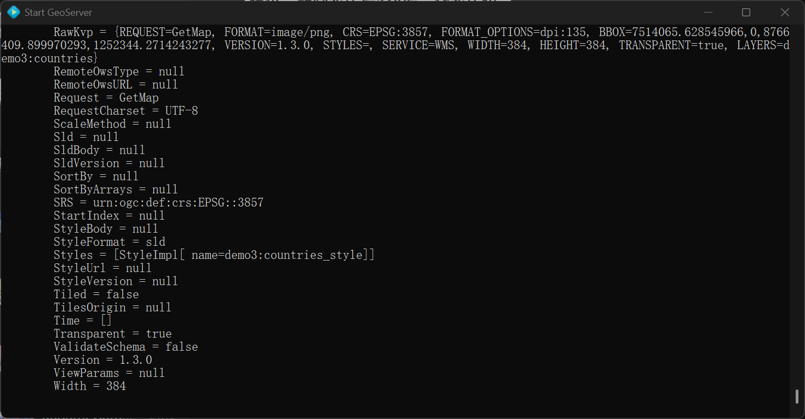
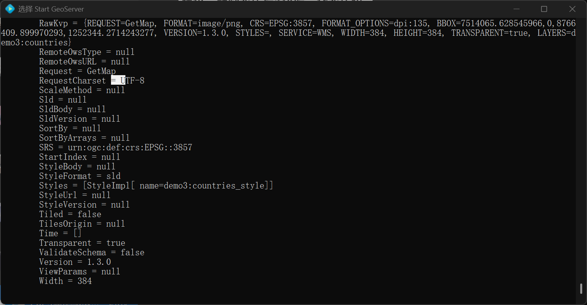
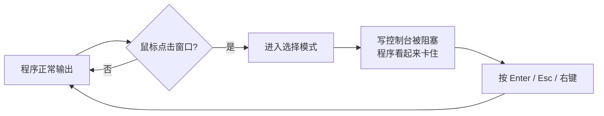
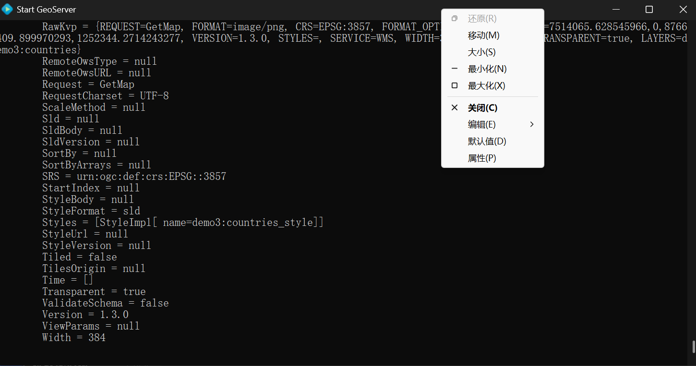
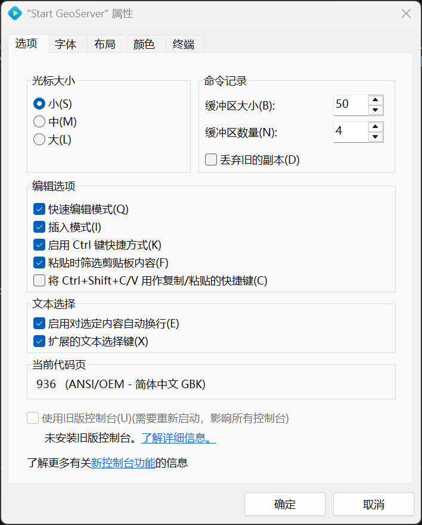

## 控制台卡住与快速编辑模式

在 cmd 里跑脚本或程序时，有时程序跑着跑着就**不动了**，但是按一下键盘（比如回车）它又继续了。这，大概率是 Windows 控制台的**快速编辑模式**的问题

> [!NOTE]
> 本节讨论的是传统控制台（conhost）中的 cmd，但是 PowerShell 在传统控制台窗口中运行时同样会遇到这个问题。使用 Windows Terminal 的话不会

### 现象

- 脚本或程序运行到一半没有任何输出，CPU 占用也很低
- 按下 `Enter`、`Esc` 或鼠标右键之后，程序立刻继续，还会一次性刷出一大堆之前积压的输出

大概是因为窗口在后台时，不小心**点了一下鼠标**

> [!TIP]
> 判断是不是这个问题很简单：卡住的时候看一眼窗口标题栏，如果标题前面多了 `选择`（英文系统为 `Select`）字样，那就是了





### 原因

快速编辑模式（QuickEdit Mode）是控制台的一项功能，**默认开启**。它让你可以直接用鼠标框选文字，再按右键复制，用起来很方便

问题在于，只要鼠标点击了控制台窗口，控制台就会进入"选择模式"。在这个模式下，程序往控制台写入输出会被**阻塞**，程序就像被暂停了一样。按回车或右键退出选择模式后，程序才会继续运行



> [!WARNING]
> 程序是**被阻塞在输出上**，不是死机。但如果你在"选择"状态下放着不管，比如挂着跑编译或下载，任务就会一直停在那里浪费时间

### 解决方法

#### 临时恢复

在卡住的窗口里按一下 `Enter` 或 `Esc`，或者点一下鼠标右键即可

#### 关闭快速编辑模式

**只对当前窗口生效：**

1. 右键 cmd 窗口的标题栏 → **属性**
2. 在**选项**页中，取消勾选**快速编辑模式**
3. 点击**确定**



**对以后所有窗口生效：**

- 在上述菜单中选择**默认值**，同样取消勾选**快速编辑模式**
- 或者直接在命令提示符中执行下面的命令：

```bat
reg add "HKCU\Console" /v QuickEdit /t REG_DWORD /d 0 /f
```

执行后**重新打开** cmd 窗口才会生效



> [!TIP]
> 关闭之后，鼠标就不能直接框选复制了。想复制内容时可以用 `Ctrl + M` 手动进入标记模式（部分版本可用），或者把输出重定向到文件再打开查看

#### 避开控制台输出

如果程序输出很多、又需要长时间挂机运行，可以把输出重定向到文件，这样就不会被选择模式阻塞：

```bat
your_program.exe > log.txt 2>&1
```

其中 `>` 表示把标准输出写入文件，`2>&1` 表示把错误输出也合并进去
