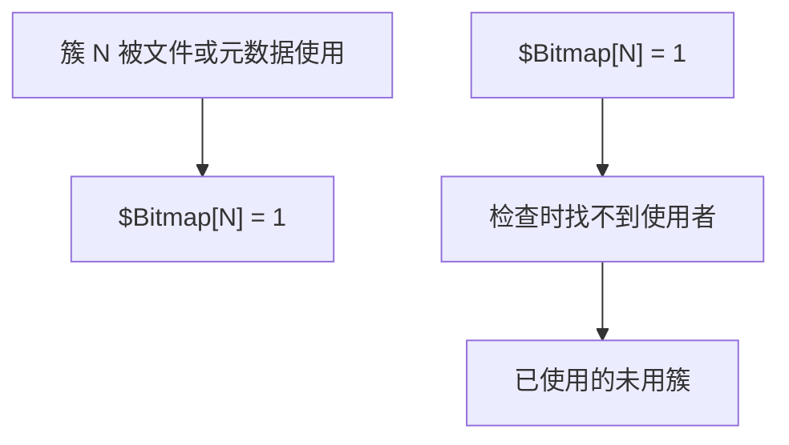

## 调整分区时提示有标记为已使用的未用簇

用 DiskGenius 调整分区大小时，可能会遇到这样的报错：

```text
$Bitmap 中有标记为已使用的未用簇
```

“已使用”和“未用”放在一起看着矛盾，其实是文件系统里两份记录对不上：Bitmap 表示这个簇已经分出去了，但整个文件系统里找不到谁在用它

### 簇与 $Bitmap

文件系统以“簇”为单位分配空间。一个文件可以占用多个簇，这些簇的位置由文件系统记录

NTFS 有一个特殊的元数据文件 `$Bitmap`，可以当作一张空间占用表，卷里每个簇对应其中一个 bit：

- `0`：空闲，可以分配
- `1`：已分配，不会再分给其他文件

`$Bitmap` 只记录“有没有被占用”，不记录“被谁占用”。文件的数据在哪些簇上，是由 MFT（主文件表）里的文件记录及其属性来描述的



### 为什么平时没事，调整分区才报错

标记为已分配的簇，分配器不会再把它交给别的文件。所以这类问题平时往往只是浪费了一点空间，不一定影响文件读写

调整分区则要改动文件系统的布局。DiskGenius 发现分配记录前后矛盾，没法确定哪些簇能安全移动或释放，就会直接中止

### 处理方法

> [!IMPORTANT]
> 先备份重要数据，再检查修复。不要为了让操作继续，直接跳过错误检查

用管理员身份打开终端，运行 Windows 自带的检查工具：

```cmd
chkdsk C: /f
```

`C:` 是要检查的卷，其他卷换成对应盘符，`/f` 表示修复发现的文件系统错误

运行完要看结果，再决定是否继续调整分区

**有案例 `chkdsk` 之后 DiskGenius 仍然拒绝调整，但 Windows 自带的扩展卷可以完成**

### 和“未用文件记录”的区别

NTFS 里用到位图的地方不止一处，排查时要把报错看完整

| 对象                     | 记录的内容                |
| ------------------------ | ------------------------- |
| 卷的 `$Bitmap`           | 卷内哪些簇已经分配        |
| `$MFT` 的 `$BITMAP` 属性 | 哪些 MFT 文件记录已经使用 |

如果提示的是“标记为已使用的未用文件记录”，检查的就是 MFT 的位图，而不是簇。两者都是分配记录不一致，但对象不同
