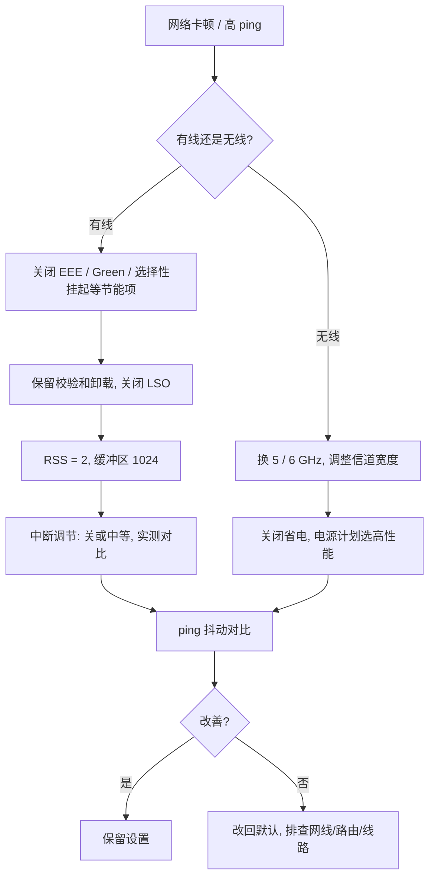

# 网卡调优

> [!WARNING]
> 正常来讲网卡的默认设置就足够使用，本文仅仅是折腾日记

网卡是电脑与网络之间的桥梁。大多数情况下默认设置已经够用

只有在游戏 ping 抖动、断流、跑不满带宽时，才需要调整网卡的高级选项

先排查，再调参，每次只改一项，改完记得测试

> [!NOTE]
> 本文默认系统为 **Windows 10/11**。有线部分以 Realtek 2.5G 网卡（如 RTL8125）为例，Intel 等其他品牌的选项名称略有差异，但逻辑相同

## 调优前的准备

### 排除干扰现象

| 现象                          | 优先排查方向                         |
| ----------------------------- | ------------------------------------ |
| 只有某一款游戏卡              | 游戏服务器、加速器、运营商线路       |
| 所有联网程序都慢              | 路由器、网线、宽带本身               |
| ping 偶尔飙高、丢包、短暂断流 | 网卡节能设置、驱动、无线干扰         |
| 测速跑不满千兆/2.5G           | 网线规格、对端接口速率、LSO/RSS 设置 |

> [!TIP]
> 能用网线就别用 Wi-Fi，能换 Cat5e/Cat6 网线就别用劣质线。很多"网卡问题"其实是网线、水晶头或路由器的问题

### 更新驱动

驱动优先从**网卡厂商官网**（Realtek、Intel 等）下载，其次是主板厂商官网。不要用来路不明的"驱动精灵"类工具

### 记录原始数据

调整之前，先测一次对比依据：

```powershell
# 对网关持续 ping，Ctrl + C 结束后看平均值和最大值
ping -t 192.168.1.1

# 对目标服务器连续 ping 100 次，看丢包率和抖动
ping -n 100 目标地址
```

> [!TIP]
> 可以配合游戏内的延迟/丢包显示一起看。ping 的平均值不是重点，**最大值与波动**才是

## 进入网卡高级设置

1. 按 `Win + X`，选择**设备管理器**
2. 展开**网络适配器**，双击你的网卡
3. 切换到**高级**选项卡，这里就是本文要调整的大部分选项
4. 切换到**电源管理**选项卡，调整供电相关选项

> [!WARNING]
> 修改某些选项时网络会短暂断开，这是正常现象。**不要在下载、传输重要文件时修改**

## 有线网卡

### 节能类：建议全部关闭

节能功能会让网卡在空闲时进入低功耗状态，唤醒时产生延迟波动。台式机几乎没有必要开启

| 选项                                         | 建议     | 说明                       |
| -------------------------------------------- | -------- | -------------------------- |
| 节能以太网 / Energy Efficient Ethernet (EEE) | **关闭** | 总开关，链路节能的主要来源 |
| Advanced EEE（增强 EEE）                     | **关闭** | 依附 EEE 总开关            |
| 环保节能 / Green Ethernet                    | **关闭** | 降低功耗的链路省电         |
| Gigabit Lite                                 | **关闭** | 千兆精简兼容模式           |
| Power Saving Mode（电源节能模式）            | **关闭** | 网卡整体省电               |
| Selective Suspend（选择性挂起）              | **关闭** | 空闲时挂起网卡             |
| ARP / NS 减负                                | **关闭** | 休眠时的协议应答卸载       |
| 流控 Flow Control                            | **关闭** | 避免拥塞回打包造成抖动     |

> [!NOTE]
> 流控存在争议：多数游戏优化指南建议关闭，也有指南建议开启接收流控以避免丢包，请做好充分测试后再做决定

### 性能类：按需调整

| 选项                             | 建议                | 说明                                           |
| -------------------------------- | ------------------- | ---------------------------------------------- |
| TCP/UDP 校验和卸载（IPv4/IPv6）  | **RX 和 TX 都开启** | 交给网卡硬件计算校验，降低 CPU 占用            |
| 大量传送卸载 LSO V2（IPv4/IPv6） | **关闭**            | 避免大包由网卡拆分造成延迟，**低延迟场景**推荐 |
| 接收端调整 RSS                   | **开启**            | 多核并行处理接收数据包                         |
| RSS 队列数                       | **2**               | 游戏场景 2 个队列足够，不必拉满                |
| 中断调节 Interrupt Moderation    | 见下文              | 在延迟与 CPU 占用之间取舍                      |
| 接收缓冲区 / 传送缓冲区          | **1024**            | 增大可减少高负载下的丢包，一般不需要调到最大   |

#### 中断调节怎么选

中断调节会让网卡**攒一批数据包再通知 CPU**，降低 CPU 占用，但会增加一点点延迟

| 场景                | 建议                                    |
| ------------------- | --------------------------------------- |
| 追求极限低延迟      | 关闭，但 CPU 占用上升，计算密集场景慎用 |
| 日常使用 / 稳定优先 | 保持默认或设为中等                      |
| 下载、NAS、服务器   | 开启，吞吐量更好                        |

> [!NOTE]
> 这两种选择的差距通常只有微秒级，普通玩家很难感知。**不要盲目关闭**

> [!WARNING]
> LSO 和中断调节的建议取决于用途。如果主要做大文件传输、跑服务器，应**开启 LSO、开启中断调节**，并适当增加 RSS 队列数

### 链路与协议类

| 选项                               | 建议         | 说明                     |
| ---------------------------------- | ------------ | ------------------------ |
| 连接速度和双工模式                 | **自动侦测** | 网线和对端正常时无需强制 |
| VLAN ID                            | `0`（默认）  | 家用不需要打 VLAN 标签   |
| QoS 数据包计划程序                 | 可取消勾选   | 游戏场景一般不需要       |
| Microsoft 网络适配器多路传送器协议 | 可取消勾选   | 不需要使用               |
| Microsoft LLDP 协议驱动程序        | 可取消勾选   | 不需要使用               |

> [!TIP]
> 如果网卡是 2.5G，但对端（光猫、路由器）只有千兆口，自动协商后实际速率是 **1 Gbps 全双工**，这是正常的

### 唤醒类

不用就关

| 选项                         | 建议       |
| ---------------------------- | ---------- |
| 唤醒魔术封包                 | 关闭       |
| 样式对比唤醒                 | 关闭       |
| Wake on Magic packet from S5 | 默认或关闭 |
| 网络唤醒和关机连接速度       | 不降速     |

### 电源管理选项卡

| 选项                           | 建议                         |
| ------------------------------ | ---------------------------- |
| 允许计算机关闭此设备以节约电源 | **取消勾选**                 |
| 允许此设备唤醒计算机           | 取消勾选（不用网络唤醒的话） |

> [!WARNING]
> 如果你需要通过局域网远程唤醒电脑（Wake on LAN），不要关闭唤醒相关选项

## 无线网卡

无线网络的瓶颈往往不在网卡驱动里，而在**环境和路由器**

### 优先级

1. 频段：优先 **5 GHz / 6 GHz**，2.4 GHz 干扰多，延迟抖动大
2. 信道：用 Wi-Fi 分析工具查看周围信号，选择较空闲的信道
3. 信道宽度：家用环境通常 80 MHz，邻居多时降到 40 MHz 更稳
4. 距离与遮挡：尽量让设备与路由器之间少隔墙

最后才是网卡驱动选项

### 网卡设置

| 选项                           | 建议                                       |
| ------------------------------ | ------------------------------------------ |
| 电源计划                       | 选**高性能**或平衡，避免"节能"             |
| 无线适配器省电模式             | 调到"最高性能"                             |
| 允许计算机关闭此设备以节约电源 | 取消勾选                                   |
| 无线模式                       | 选择网卡支持的最高标准（如 802.11ax）      |
| 漫游敏感度                     | 移动设备可调高；固定的台式机保持默认或调低 |

> [!NOTE]
> 不同品牌（Intel、MediaTek、Realtek）无线网卡的选项名称和效果差别较大，无法一概而论

> [!TIP]
> 蓝牙设备和 2.4 GHz Wi-Fi 共用频段，会互相干扰。如果蓝牙耳机、键鼠经常卡顿，优先切换到 5 GHz

## 进阶

### 查看和修改 RSS

RSS 就是 Receive Side Scaling 多队列接收，网卡把收到的数据包分散到多个 CPU 核心处理，避免所有收包工作都压在单个核心上

```powershell
# 查看当前 RSS 设置
Get-NetAdapterRss

# 将 RSS 起始核心设为 2（避开核心 0）
Set-NetAdapterRss -Name "以太网" -BaseProcessorNumber 2
```

其中 `以太网` 需要替换为你的网卡名称，可用 `Get-NetAdapter` 查看

> [!NOTE]
> 现代网卡一般默认使用 MSI/MSI-X 中断，无需额外设置。除非有明确问题，否则不建议手动修改中断亲和性

## 推荐流程



## 常见问题

### 改完之后网络反而变差

先把该选项改回默认值。如果改动较多，可在设备管理器中卸载网卡驱动后重启，Windows 会重新安装并恢复默认设置

### 游戏 ping 突然抖动或断流

1. 检查网卡节能项（EEE、Green Ethernet、选择性挂起）是否已关闭
2. 检查电源管理选项卡是否取消了"允许计算机关闭此设备以节约电源"
3. 更换网线、换一个路由器 LAN 口测试
4. 更新或回退网卡驱动

### 测速跑不满带宽

1. 确认网线规格（千兆至少 Cat5e，2.5G 建议 Cat6）
2. 确认对端接口速率，在网卡属性或`网络和 Internet`设置里查看协商速率
3. 确认 LSO、校验和卸载是否被误关
4. 避免使用性能很弱的 USB 网卡或网线转接头

> [!IMPORTANT]
> 网上很多"关掉这几个功能解决 90% 延迟"的文章来自个人经验，不是严格测试，且每个人的网络、电脑环境都不一样，**每改一项都要实测，有效才保留**
